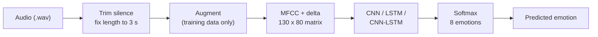

<h1 align="center">🎙️ Speech Emotion Recognition</h1>

<p align="center">
  Recognize human emotions (angry, happy, sad and more) from speech audio<br>
  using <b>MFCC features</b> and <b>deep learning</b> (CNN / LSTM / CNN-LSTM).
</p>

<p align="center">
  
  
  
  
  
</p>

<!-- After deploying, add your app link here:
<p align="center"><a href="YOUR_APP_URL"></a></p>
-->

<p align="center">
  
</p>

---

## 📑 Table of contents

- [Overview](#-overview)
- [How it works](#-how-it-works)
- [Results](#-results)
- [Project structure](#-project-structure)
- [Getting started](#-getting-started)
- [Use the web app](#-use-the-web-app)
- [Train the models](#-train-the-models)
- [Predict from the command line](#-predict-from-the-command-line)
- [Model architectures](#-model-architectures)
- [Limitations and future work](#-limitations-and-future-work)
- [Troubleshooting](#-troubleshooting)
- [Dataset and credits](#-dataset-and-credits)

---

## 🔎 Overview

This project classifies a short speech recording into one of **8 emotions**:
`neutral`, `calm`, `happy`, `sad`, `angry`, `fearful`, `disgust`, `surprised`.

**Highlights**

- 🎧 Audio features: 40 **MFCCs** plus their delta (velocity) features
- 🧠 Three models compared: **CNN**, **LSTM** and **CNN-LSTM**
- 🧪 **Speaker-independent** evaluation: the test actors never appear in training
- 🔁 Data augmentation: noise, pitch shift and time stretch (training data only)
- 🌐 A **Streamlit web app** to upload or record audio and see the prediction

---

## ⚙️ How it works



1. Each clip is loaded at 22.05 kHz, trimmed of silence and fixed to 3 seconds.
2. 40 MFCCs and their deltas give a `130 x 80` feature matrix per clip.
3. Training clips get one augmented copy (noise, pitch shift or time stretch).
4. The model outputs a probability for each of the 8 emotions.
5. Actors 1-20 are used for training and validation, and actors 21-24 are held out for testing.

---

## 📊 Results

Evaluated on **240 clips from 4 unseen actors** (RAVDESS speech, actors 21-24).

| Model | Accuracy | Macro F1 |
|-------|:--------:|:--------:|
| **CNN** | **58.8%** | **0.561** |
| CNN-LSTM | 52.1% | 0.503 |
| LSTM | 45.4% | 0.457 |

Random guessing over 8 emotions would give 12.5%.

> The test set is small (240 clips), so differences of a few points between models
> can be noise. The gap between the CNN and the LSTM is the clearest result.

<details>
<summary><b>Why does the CNN win?</b></summary>

MFCC features already describe each moment of the voice well, and a CNN is good at picking
up local patterns in them. With only about 2,000 training clips, the simpler model
generalizes better than the recurrent ones.

</details>

---

## 📁 Project structure

```
Speech_Emotion/
├── app.py                  # Streamlit web app
├── requirements.txt        # packages needed to run the app
├── README.md
├── assets/
│   └── app_screenshot.png
├── data/
│   └── RAVDESS/            # dataset (not included in the repository)
│       └── Actor_01 ... Actor_24/
├── outputs/                # trained model, normalization stats, plots, reports
│   ├── cnn_best.keras
│   └── norm_stats.npz
└── src/
    ├── features.py         # load audio, augment, extract MFCC
    ├── dataset.py          # read RAVDESS, parse labels, speaker split
    ├── models.py           # CNN, LSTM and CNN-LSTM definitions
    ├── train.py            # training and evaluation
    └── predict.py          # predict the emotion of one file
```

---

## 🚀 Getting started

**1. Clone the repository**

```bash
git clone https://github.com/adarshkasaudhan774-spec/CodeAlpha_Speech_Emotion_Recognition.git
cd CodeAlpha_Speech_Emotion_Recognition
```

**2. Create and activate a virtual environment**

<details open>
<summary><b>Windows (PowerShell)</b></summary>

```powershell
python -m venv venv
venv\Scripts\activate
```

If PowerShell blocks the script, run this once and try again:

```powershell
Set-ExecutionPolicy -Scope CurrentUser -ExecutionPolicy RemoteSigned
```

</details>

<details>
<summary><b>macOS / Linux</b></summary>

```bash
python3 -m venv venv
source venv/bin/activate
```

</details>

**3. Install the packages**

```bash
pip install -r requirements.txt
```

To train the models yourself, also install:

```bash
pip install scikit-learn matplotlib seaborn
```

**4. (Only for training) Download the dataset**

Get **RAVDESS Emotional Speech Audio** from
[Kaggle](https://www.kaggle.com/datasets/uwrfkaggler/ravdess-emotional-speech-audio)
and place the `Actor_01 ... Actor_24` folders in `data/RAVDESS/`. You should have 1,440 `.wav` files.

---

## 🖥️ Use the web app

```bash
python -m streamlit run app.py
```

The app opens at `http://localhost:8501`.

| Step | What to do |
|------|------------|
| 1 | Choose a model in the sidebar (`cnn` is the default and the best one) |
| 2 | Open **Upload a file** and choose a `.wav` file, or open **Record with microphone** |
| 3 | The predicted emotion and a bar chart of all 8 probabilities appear |

**Tips:** speak clearly with strong, acted emotion, in a quiet room, for 1-3 seconds.

---

## 🏋️ Train the models

Run these from the project folder:

```bash
python src/train.py                  # trains the CNN-LSTM
python src/train.py --model cnn      # cnn, lstm or cnn_lstm
python src/train.py --model all      # trains all three and compares them
python src/train.py --epochs 40      # fewer epochs for a faster run
python src/train.py --rebuild        # re-extract features instead of using the cache
```

Results are saved in `outputs/`: the best model (`<name>_best.keras`), confusion matrix,
training curves, a classification report, `model_comparison.csv` and `norm_stats.npz`.

The first run extracts features from all 1,440 files, which takes a few minutes.
They are cached afterwards, so later runs start quickly.

---

## 🎯 Predict from the command line

```bash
python src/predict.py "data/RAVDESS/Actor_21/03-01-05-01-01-01-21.wav" --model cnn
```

Example output:

```
Predicted emotion: angry  (85.8%)

angry       85.8%
sad          5.3%
happy        5.0%
...
```

<details>
<summary><b>How to read RAVDESS filenames (true labels)</b></summary>

A filename such as `03-01-05-01-01-01-21.wav` has 7 parts. The **third** is the emotion and the **last** is the actor.

| Code | Emotion |
|:----:|---------|
| 01 | neutral |
| 02 | calm |
| 03 | happy |
| 04 | sad |
| 05 | angry |
| 06 | fearful |
| 07 | disgust |
| 08 | surprised |

So the file above (`05`, actor 21) is an **angry** clip from a test actor.

</details>

---

## 🧱 Model architectures

<details>
<summary><b>CNN (best model)</b></summary>

- 3 x [Conv1D (64, 128, 128 filters, kernel 5) + BatchNorm + MaxPool + Dropout 0.3]
- Global average pooling
- Dense 64 (ReLU) + Dropout 0.4
- Dense 8 (softmax)

</details>

<details>
<summary><b>LSTM</b></summary>

- LSTM 128 (return sequences) + Dropout 0.3
- LSTM 64
- Dense 64 (ReLU) + Dropout 0.4
- Dense 8 (softmax)

</details>

<details>
<summary><b>CNN-LSTM</b></summary>

- 2 x [Conv1D (64, 128 filters, kernel 5) + BatchNorm + MaxPool + Dropout 0.3]
- Bidirectional LSTM 128
- Dense 64 (ReLU) + Dropout 0.4
- Dense 8 (softmax)

</details>

All models use the Adam optimizer, class weights (the `neutral` class has half as many clips),
early stopping and learning-rate reduction.

---

## ⚠️ Limitations and future work

- Trained only on **acted English speech**, so accuracy on real conversations and other
  microphones or languages is lower.
- The model can be **confidently wrong**. The percentage shown is not a guarantee of correctness.
- Quiet emotions (`sad`, `calm`, `neutral`) are often confused with each other.

**Ideas for improvement**

- [ ] Add more features (mel-spectrogram, chroma, zero-crossing rate, energy)
- [ ] Use more augmented copies per clip
- [ ] Combine RAVDESS with TESS and EMO-DB
- [ ] Fine-tune a pretrained model such as wav2vec 2.0 or HuBERT

---

## 🛠️ Troubleshooting

<details>
<summary><b><code>python</code> is not recognized (Windows)</b></summary>

Python is not installed or not on your PATH. Install it from python.org and tick
**Add python.exe to PATH**, then restart the terminal.

</details>

<details>
<summary><b><code>streamlit</code> is not recognized</b></summary>

Use `python -m streamlit run app.py` instead, and make sure the virtual environment is active.

</details>

<details>
<summary><b><code>ModuleNotFoundError</code></b></summary>

The virtual environment is not active, or the packages are missing. Activate it and run
`pip install -r requirements.txt`.

</details>

<details>
<summary><b>The app says no trained model was found</b></summary>

`outputs/cnn_best.keras` and `outputs/norm_stats.npz` must exist. Train the model with
`python src/train.py --model cnn`.

</details>

<details>
<summary><b><code>ConnectionResetError: [WinError 10054]</code> in the terminal</b></summary>

This is harmless. It appears on Windows when the browser tab reloads or closes.

</details>

---

## 📚 Dataset and credits

- **RAVDESS** (Ryerson Audio-Visual Database of Emotional Speech and Song): Livingstone &amp; Russo (2018).
  The dataset is not included in this repository. See its
  [Kaggle page](https://www.kaggle.com/datasets/uwrfkaggler/ravdess-emotional-speech-audio)
  for the license terms and cite the original paper if you use it in academic work.
- Built with [TensorFlow / Keras](https://keras.io), [librosa](https://librosa.org) and [Streamlit](https://streamlit.io).
